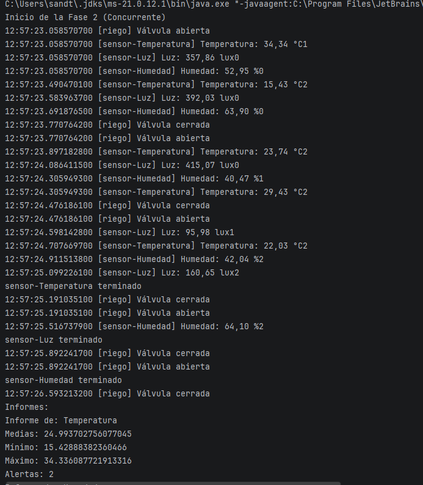

# Invernadero con hilos

## Qué hace
Este proyecto es una simulación del sistema de monitorización de un invernadero en Java. El sistema lee datos de tres sensores (Temperatura, Humedad y Luz) y controla la apertura de una válvula de riego automático[cite: 5]. El prototipo demuestra la diferencia de rendimiento entre ejecutar estas tareas de forma secuencial (una tras otra, sumando tiempos) frente a ejecutarlas de manera concurrente mediante programación multihilo (donde el tiempo total es igual al de la tarea más larga)[cite: 5].

## Cómo ejecutarlo
El proyecto consta de cuatro fases distintas que pueden ejecutarse desde IntelliJ IDEA (con JDK 21)[cite: 4, 11]. Cada fase tiene su propio método `main`:
1. **Fase1_Secuencial**: Ejecuta los sensores uno detrás de otro.
2. **Fase2_Concurrente**: Ejecuta todos los dispositivos a la vez usando hilos.
3. **Fase3_Experimentos**: Realiza pruebas forzando errores y comportamientos asíncronos.
4. **Fase4_Vigilante**: Lanza un hilo demonio que monitoriza el estado del resto de procesos en tiempo real.

## Captura

## Resultados

| Versión | Tiempo Total | Comportamiento |
| :--- | :--- | :--- |
| Fase 1 (Secuencial) | 11.175 ms | Ejecución lineal, suma de los tiempos. |
| Fase 2 (Concurrente) | 3.562 ms | Ejecución en paralelo, tiempo dictado por el proceso más largo. |

**Análisis de la ejecución (Fase 2):**
En la versión concurrente, los mensajes en la consola aparecen desordenados porque los cuatro hilos trabajan de forma independiente y simultánea compitiendo por los recursos del sistema. El tiempo total se reduce de 11 segundos a 3,5 segundos porque las esperas ocurren al mismo tiempo.

## Análisis

### ¿Por qué compensa usar hilos en el invernadero?
Compensa drásticamente porque en un sistema secuencial, si el programador de riego está ocupado esperando 700ms entre aperturas, el sistema no está leyendo la temperatura y podría perderse una alerta crítica. Con hilos, todos los sensores vigilan sus umbrales al mismo tiempo, logrando una mayor seguridad y reduciendo el tiempo total de ejecución del ciclo completo[cite: 5].

### Experimentos A, B y C
* **Experimento A:** Al no usar `join()` la primera vez, el hilo principal (`main`) no espera a que el sensor recopile las lecturas e imprime el informe inmediatamente (saliendo vacío o con valores a cero). Tras utilizar `join()`, el `main` se bloquea hasta que el hilo termina, imprimiendo el informe de manera correcta.
* **Experimento B:** Al llamar a `.run()` en lugar de `.start()`, el código se ejecuta en el propio hilo `main` en lugar de crear un subproceso nuevo. Por este motivo, el estado del objeto Thread se queda en `NEW` (nunca arrancó como hilo independiente)[cite: 8].
* **Experimento C:** Al intentar hacer `.start()` sobre un hilo ya finalizado, se lanza una `IllegalThreadStateException`. Esto demuestra que los hilos en Java son de un solo uso; una vez alcanzan el estado `TERMINATED`, no pueden volver a ejecutarse[cite: 8].

### Estados observados
* **`NEW`**: Antes de llamar a `.start()`. Se provoca al instanciar el hilo con `new Thread()`[cite: 9].
* **`RUNNABLE`**: Cuando el hilo arranca. Provocado por la línea `start()` y cuando está procesando los datos de los sensores[cite: 9].
* **`TIMED_WAITING`**: Cuando el hilo detiene su ejecución temporalmente. Provocado por las llamadas a `Thread.sleep(periodo)`[cite: 9].
* **`TERMINATED`**: Cuando el método `run()` acaba por completo. Ocurre tras el `join()`[cite: 9].

**¿Por qué termina el programa si el vigilante sigue en su bucle?**
El programa termina porque el vigilante fue configurado como un hilo demonio (`setDaemon(true)`). La máquina virtual de Java (JVM) finaliza automáticamente la ejecución en cuanto no queda ningún hilo "usuario" (los sensores y el riego) activo, llevándose por delante al vigilante demonio aunque esté en un `while(true)`[cite: 8, 10].

### Thread frente a Runnable

| Aspecto | `Thread` | `Runnable` |
| :--- | :--- | :--- |
| **Implementación** | Herencia (`extends Thread`) | Interfaz (`implements Runnable`)[cite: 9] |
| **Herencia Múltiple** | No permite heredar de otra clase. | Sí permite heredar de otras clases base[cite: 9]. |
| **Concepto** | Representa al hilo en sí mismo. | Representa la tarea que ejecutará el hilo[cite: 9]. |
| **Arranque** | `objeto.start()` | `new Thread(objeto).start()`[cite: 9] |

**¿Por qué los sensores SOLO pueden ser Runnable en tu diseño?**
Porque en este diseño los sensores ya heredan de una clase abstracta padre llamada `Sensor` (`extends Sensor`)[cite: 6]. Dado que Java no permite la herencia múltiple de clases, es imposible que hereden también de `Thread` al mismo tiempo. Implementar la interfaz `Runnable` es la única solución viable[cite: 9].

**¿Qué forma elegirías para el riego y por qué?**
Para el riego es idóneo utilizar `extends Thread` porque se trata de un componente completamente autónomo que no necesita heredar atributos ni comportamientos de otra clase base, lo que simplifica la sintaxis de instanciación y arranque directo[cite: 6, 9].